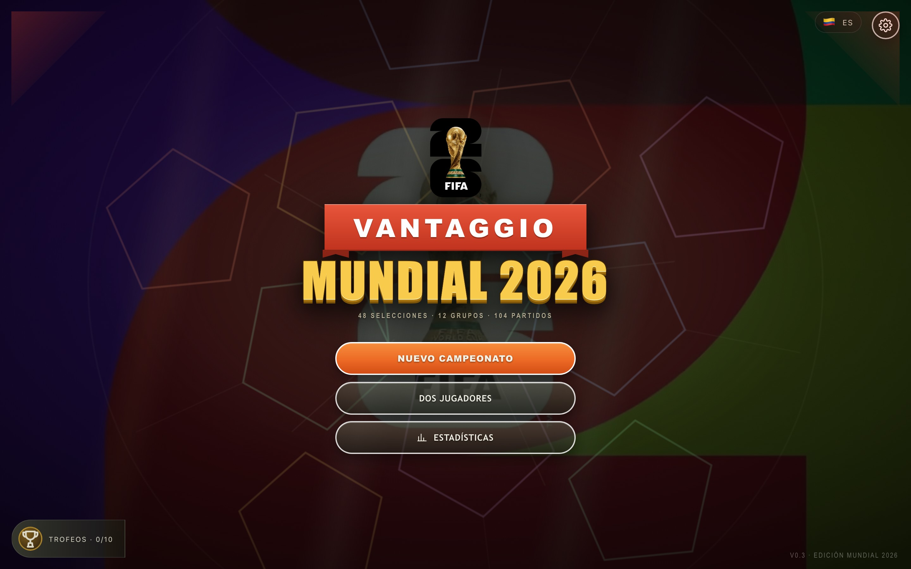
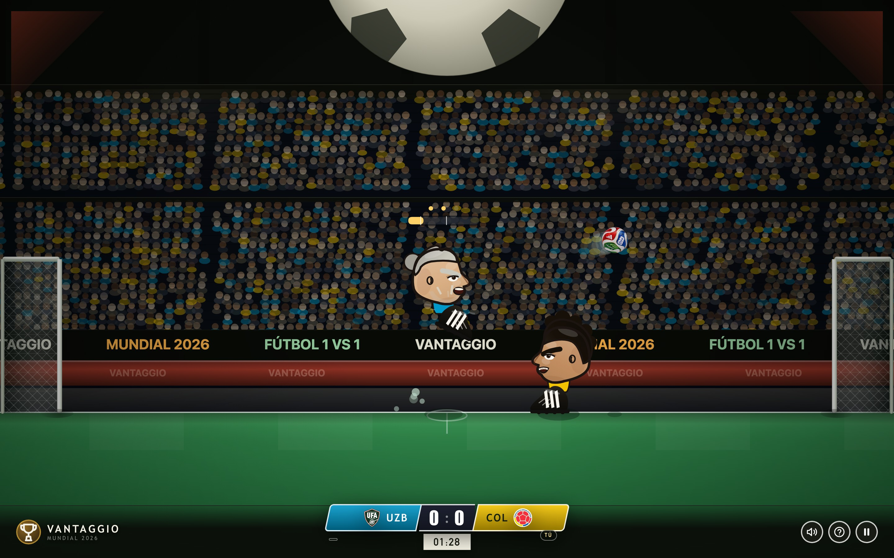
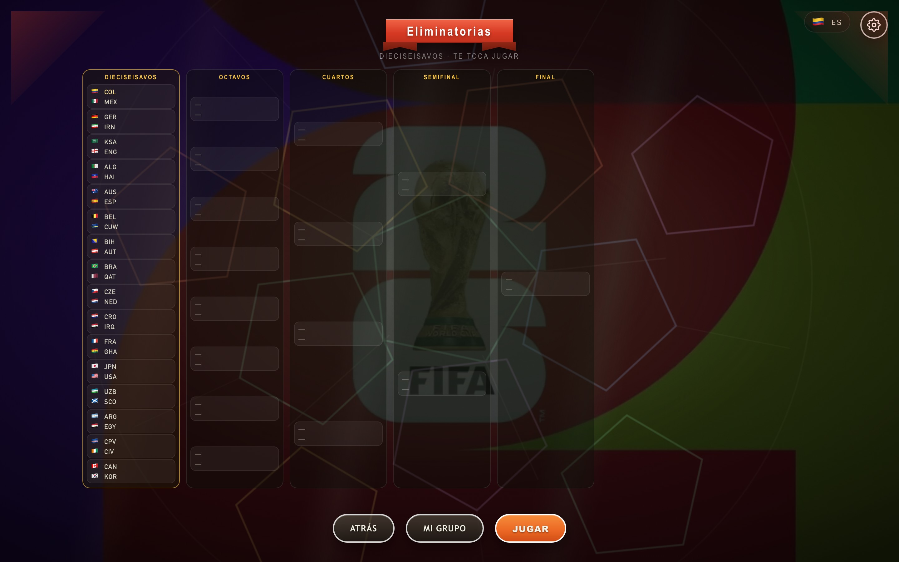
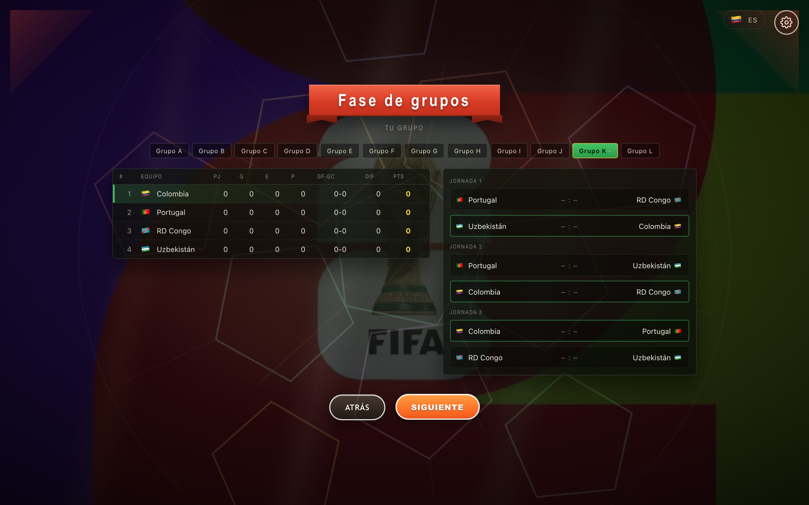
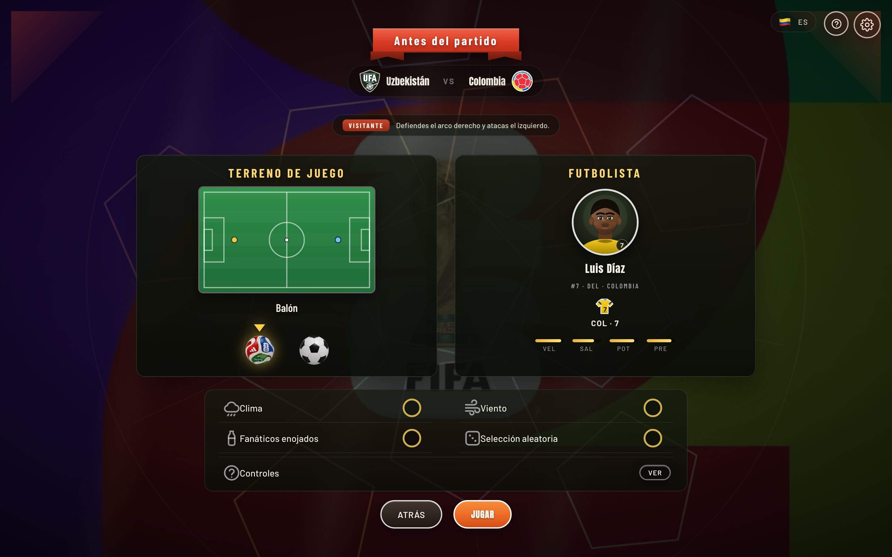
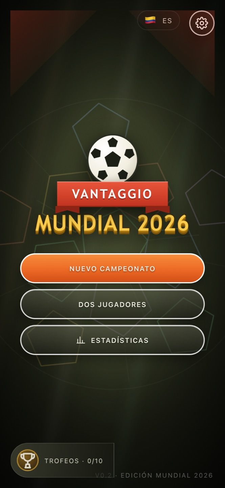

# Vantaggio — Mundial 2026

Fútbol **1 vs 1** de cabezones. Una sola edición: el **Mundial 2026** con sus 48 selecciones
reales. Español latinoamericano. Inspirado en DVADI, con motor, física y arte propios.

> *Entras y a los cinco segundos estás pateando.*



---

## Lo que ya está (v0.3)

| Pantalla | Qué hace |
|---|---|
| **Menú** | Emblema real del Mundial 2026, nuevo campeonato, dos jugadores y trofeos. Si hay un campeonato a medias, "Continuar". |
| **Dificultad** | Fácil · Normal · Difícil · Legendario. Cambia reacción, puntería, colocación, uso del dash, salto de bloqueo y velocidad. |
| **Selección** | 48 selecciones y **5 futbolistas elegibles** por selección, con escudo, dorsal y atributos. La estrella viene seleccionada por defecto. |
| **Antes del partido** | Balón, clima, viento y fanáticos. Muestra si juegas de **local o visitante**. Los controles viven en un panel aparte (botón «?» y fila «Controles») para que «Jugar» siempre quede a la vista. En 2 jugadores, además, a cuántos goles se gana (3, 5 o 7). |
| **Fase de grupos** | Los 12 grupos reales del torneo, tabla en vivo y cruces por jornada. Puedes mirar los otros grupos sin perder el tuyo. |
| **Eliminatorias** | Dieciseisavos, octavos, cuartos, semifinal y final. Pasan los dos primeros de cada grupo y los ocho mejores terceros (32 equipos). Los partidos ajenos se simulan; los empates se definen en penales. Si te eliminan, **el cuadro se juega hasta el final** y la pantalla muestra campeón, subcampeón y goleador. |
| **Partido** | Estadio ilustrado, marcador, reloj, pausa, ayuda y controles táctiles. Tú defiendes el arco que te toque según seas local o visitante. |
| **Resultado** | Marcador, remates, cabezazos, **posesión en %**, penales, abandono y **los goles con su minuto y autor**. |
| **Estadísticas del torneo** | Se abren desde dentro del campeonato (grupos, resultado y campeón): totales, **tu torneo en %** (victorias, derrotas, goles) y **goleadores**. Es 1 contra 1, así que no hay asistencias. |
| **Trofeos** | Diez logros que se desbloquean jugando. |

<table>
<tr>
<td></td>
<td></td>
</tr>
<tr>
<td></td>
<td></td>
</tr>
</table>

Móvil, en vertical:



---

## Arrancar

```bash
cd vantaggio
npm install
npm run dev        # http://127.0.0.1:5173
```

| Comando | Qué hace |
|---|---|
| `npm run dev` | Servidor de desarrollo con recarga en caliente |
| `npm test` | 60 pruebas del motor, del cuadro y de las tablas, sin navegador |
| `npm run build` | `tsc` + `vite build` → `dist/` (~52 KB gzip + arte en `public/`) |

Node 20 o superior. Cero dependencias en runtime.

El arte vive en dos capas: **los recursos reales** en `public/` (los 48 escudos SVG, la
Trionda, el balón clásico y el emblema del Mundial) y **todo lo demás dibujado** con SVG
y Canvas (personajes, estadio, arcos, red, interfaz). Nada de sprites pesados.

---

## Cómo se juega

1. **Nuevo campeonato** → eliges dificultad → eliges el **sorteo** (real o aleatorio) → eliges selección y futbolista.
2. Caés en tu grupo (el que te tocó en el sorteo). La pantalla muestra la tabla y los cruces.
3. **Siguiente** juega tu partido de esa jornada; el resto de la jornada se simula en todos los grupos.
4. Cada partido termina al llegar a **90 segundos** de reloj.
5. Si quedas entre los 32, sigues en **eliminatorias**. Cada ronda la juegas tú; los demás cruces se simulan. Un empate se define en penales.
6. En **Dos jugadores** no hay reloj: gana el primero que llegue a los goles elegidos (3, 5 o 7).

### Controles

| Acción | Jugador 1 | Jugador 2 |
|---|---|---|
| Mover | `A` / `D` | `←` / `→` |
| Saltar | `W` | `↑` |
| Bajar el remate | `S` | `↓` |
| Patear (mantener = cargar) | `Espacio` / `X` | `Enter` / `Num 0` |
| Arranque | `Shift` / `C` | `/` / `Num .` |
| Pausa | `Esc` | `Esc` |

**Contra la máquina** puedes jugar con WASD **o** con las flechas, y patear con `Espacio`
o `Enter`. El marcador te marca con **TÚ** el lado que controlas. En dos jugadores, el
marcador distingue **P1** y **P2**.

En el teléfono aparecen botones táctiles. Mejor en horizontal.

### La patada

Mantener **patear** carga el remate en tres niveles:

- **Toque** (< 0,15 s) → pase corto.
- **Media carga** (0,15–0,46 s) → remate normal.
- **Carga completa** (> 0,46 s) → bomba, más fuerte y más alta.

Con `↑` el tiro sale alto; con `↓`, raso. Mientras cargas te mueves a media velocidad.
El balón se patea **hacia donde está el balón**, no hacia donde mira el cuerpo.

### El saque

Al empezar el partido y después de cada gol, **el balón baja del techo** en el punto
central: entra por arriba, cae con su haz de luz y se asienta en el pasto (no bota). El
juego arranca cuando el balón toca el césped, así que la caída es parte del saque, no un
adorno. Cada futbolista espera **junto a su propio arco**, fuera de la red: el saque es
una carrera al centro, igual para los dos.

### Los futbolistas

Cada selección trae cinco jugadores con velocidad, salto, potencia y precisión distintas.
Esos atributos **sí afectan la simulación**:

- `spd` → velocidad máxima de carrera.
- `jmp` → altura del salto.
- `pow` → potencia del remate.
- `pre` → dispersión del tiro.

El futbolista que eliges es el que ves en la cancha: pelo, barba y tono de piel salen de
su nombre, y la vista previa usa exactamente la misma cara.

### El bot

Los cuatro niveles comparten el mismo repertorio: presionar, esperar, contragolpear,
picar, rematar raso, cabecear y amagar. Lo que cambia es la frecuencia, la velocidad y la
calidad con la que lo ejecutan.

- **Siempre quiere ganar**: no se queda quieto aunque vaya arriba en el marcador.
- **Defiende por el lado del balón**: cuando el balón ronda su arco se coloca entre el
  balón y la red, y despeja hacia la cancha. Ya no se hace autogoles.
- **Aprende**: recuerda a qué lado rematas, desde dónde y si sueles picar el balón.

---

## Estructura

```
src/
  app.ts            máquina de estados, flujo de partido, local/visita, guardado
  data/
    teams.ts        48 selecciones · 240 futbolistas · 12 grupos
    tournament.ts   cruces, tablas y simulación de resultados
    knockout.ts     clasificados, cuadro de 32, penales y avance de rondas
    look.ts         cara, pelo y barba deterministas por futbolista
    achievements.ts los diez trofeos
  sim/              motor puro, sin DOM (corre en Node)
    config.ts       todos los números de "sensación"
    world.ts        física, colisiones, reglas, partículas
    bot.ts          bot por niveles, patrones y memoria del rival
    test.ts         110 pruebas
  render/
    render.ts       jugadores, balón, partículas, clima
    arte.ts         cabezas dibujadas y catálogo de guayos
    stadium.ts      estadio: gradas, listón LED, arcos, césped
  core/             bucle fijo a 240 Hz, entrada, audio WebAudio
  ui/
    kit.ts          helpers de DOM y arte SVG (escudos, caras, balones)
    screens.ts      las diez pantallas
    hud.ts          marcador, reloj, pausa y ayuda
    state.ts        estado y guardado
  styles.css        sistema de diseño (listones, píldoras, paneles, tipografía)
```

La simulación corre a **240 Hz** y el render a la tasa del monitor. El balón viaja a
42 m/s: a 60 Hz atravesaría las colisiones.

La física es **determinista** (sin `Math.random` en el motor ni en el bot). Eso habilita
más adelante el desafío por código y, si se quiere, el online.

### Arte del futbolista

El muñeco tiene tres piezas y cada una tiene su origen:

| Pieza | De dónde sale |
|---|---|
| **Cuerpo** | Lo dibuja `render.ts` con los colores del equipo: camiseta con manga, pantaloneta, medias y ribete. No hay uniforme dibujado, así que los 48 equipos se distinguen sin necesitar 48 archivos. |
| **Guayos** | Seis pares dibujados en `public/arte/guayos/`. A cada futbolista le toca uno al azar **pero fijo**: el sorteo sale de su nombre y el de su selección, así que el mismo jugador lleva siempre el mismo par y dos compañeros no van iguales. |
| **Cabeza** | Si la selección trae retrato dibujado se usa ese; si no, la de vectores de siempre. |

```
arte/guayos/                       ← originales (los SVG de la carpeta guayos)
public/arte/guayos/<par>.webp      ← lo que sirve el juego, recortado
public/arte/jugadores/<equipo>/    ← retratos por equipo
  cabeza.svg      el retrato, mirando a la IZQUIERDA (el juego lo espeja)
```

Los SVG de los guayos traen **los dos zapatos** en el mismo archivo y pesan entre
1 y 5 MB, así que no se pueden mandar tal cual al navegador. `prep-guayos.mjs`
toma el zapato de arriba, le quita el aire transparente y deja un WebP de 420 px
(≈26 KB por par):

```bash
node scripts/prep-guayos.mjs     # ~/Downloads/guayos/*.svg → public/arte/guayos/
```

Los retratos se declaran en `src/render/arte.ts` con la ventana a recortar dentro
del archivo y, opcionalmente, el **nombre del futbolista** del roster. Si se
declara el nombre, el arte es solo suyo; si se omite, vale para toda la
selección. El retrato se muestra además en la selección de equipo y en la
antesala.

Hoy hay un futbolista con retrato dibujado: **Julián Andrés Quiñones**
(`mexico`). El resto usa la cabeza de vectores hasta que lleguen los suyos.

Todo se rasteriza una sola vez (nada de cargar SVG por cuadro) y se dibuja como
imagen: la bota lejana, la cercana y la cabeza, en ese orden.

---

## Datos del torneo

Las 48 selecciones y sus 12 grupos son los reales del sorteo. Los planteles son
**provisionales**: se eligieron cinco internacionales reconocibles por selección, no la
convocatoria oficial. Las tres selecciones con nombres menos verificados son **Haití,
Curazao y Jordania** — hay que revisarlas contra la lista definitiva antes de publicar.

Los escudos son los archivos SVG que aportaste (los 48); el balón y el emblema también
son tus recursos. El kit vectorial de presentación no se usa como asset suelto.

---

## Límites conocidos

- **Sin online**: dos jugadores comparten el mismo teclado.
- **Sin cuenta**: el progreso vive en `localStorage`. Cambiar de equipo o de navegador lo pierde.
  Google invisible y el código de progreso están diseñados pero no construidos.
- **Penales**: se simulan cuando un partido de eliminatorias termina empatado; no hay
  minijuego de penales.
- El **clima** cambia el roce del balón y el **viento** lo empuja de verdad; los fanáticos
  son solo visuales.
- El estadio sigue muy cargado de grada: la cancha ocupa una franja baja de la pantalla.
- El arte pesa: los tres SVG de México son **3,6 MB** y se cargan al entrar al partido
  (o al abrir la selección de equipo, si ese futbolista tiene retrato). Con las 48
  selecciones así serían ~170 MB: hay que optimizar (SVGO o PNG rasterizado).
- El arte trae **cabeza, camiseta y guayos**. Las piernas no existen en el dibujo, así
  que la figura queda cabezón + pecho + botín: no hay pantaloneta ni medias dibujadas.
  El botín tiene que quedarse en el pasto, y por eso no puede subir a pegarse al pecho
  como en la lámina original.
- Los tamaños y anclajes del muñeco de arte están juntos en `ARTE_TUNE`
  (`src/render/render.ts`), en radios de cabeza: `headH`, `kitW`, `kitBand`, `kitX`,
  `inclinacion`, `shoeW` y `shoeX`. En desarrollo se pueden mover en vivo desde la
  consola (`__arteTune.kitW = 1.4`) sin recargar, y `scripts/medir-cuello.mjs` mide
  dónde cae el ribete de una camiseta nueva para declarar su `cuello`.

---

## Pruebas

`npm test` corre el motor sin navegador: rebotes, goles, reinicio, separación de cuerpos,
balón acotado, determinismo, 120 s de bot contra bot, escala de dificultad, bot que no
patea hacia su arco, clasificados y cuadro de eliminatorias, y el jugador como visitante.

Las capturas de `docs/capturas/` se generan con un Chromium headless sobre la app real.

---

## Siguiente

1. Minijuego de penales.
2. Guardado con Google (o código de progreso).
3. Celebraciones elegibles.
4. Aligerar la grada y agrandar la cancha en pantalla.
